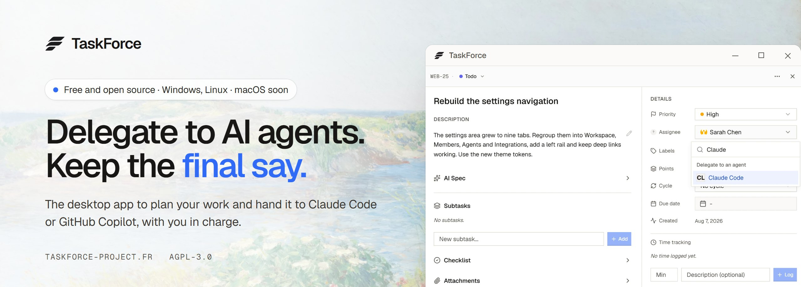
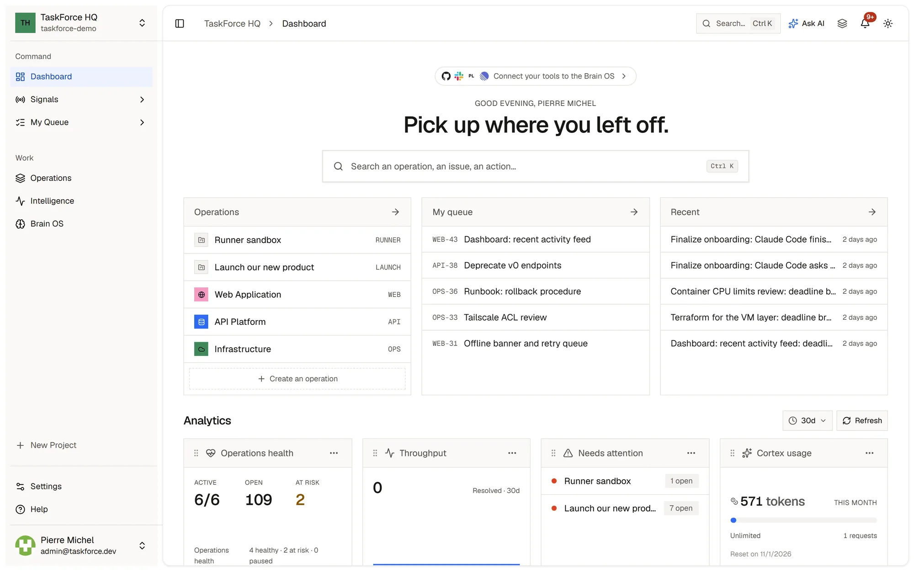
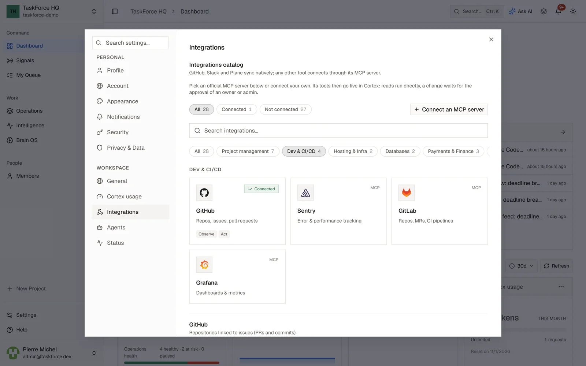
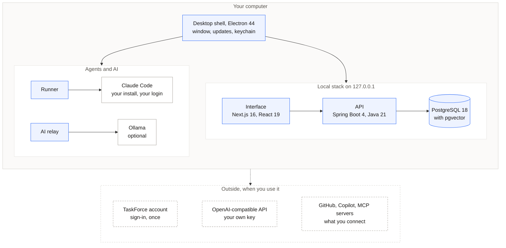

<p align="center">
  <a href="https://taskforce-project.fr">
    
  </a>
</p>

<p align="center">
  <b>TaskForce is a free, open source desktop app to plan your work and hand it to Claude Code or GitHub Copilot.</b><br />
  Agents work on their own branch, ask before anything risky, and never merge without you.
</p>

<p align="center">
  <a href="https://taskforce-project.fr/download"><b>Download</b></a>
  &nbsp;·&nbsp;
  <a href="https://taskforce-project.fr"><b>Website</b></a>
  &nbsp;·&nbsp;
  <a href="https://docs.taskforce-project.fr"><b>Documentation</b></a>
  &nbsp;·&nbsp;
  <a href="./SELF_HOSTING.md"><b>Self-hosting</b></a>
  &nbsp;·&nbsp;
  <a href="./CONTRIBUTING.md"><b>Contributing</b></a>
</p>

<p align="center">
  <a href="https://github.com/taskforce-project/taskforce-fullstack"></a>
  <a href="https://github.com/taskforce-project/taskforce-fullstack/releases/tag/desktop-latest"></a>
  <a href="./LICENSE"></a>
  <a href="https://taskforce-project.fr/download"></a>
</p>

<br />

## Why TaskForce

Coding agents are fast. Working with them is still messy: context gets lost between tools, you can't see what an
agent is doing, and its results land unchecked.

TaskForce puts the plan, the project's memory and the agents in one app, on your computer, with you in charge.

<table>
  <tr>
    <td width="33%" valign="top">
      <b>Context comes with the task</b><br />
      Agents look up your decisions and conventions in Brain OS before they start, so they never begin from a blank page.
    </td>
    <td width="33%" valign="top">
      <b>Every step in plain sight</b><br />
      Follow each file an agent reads, each edit and each command, live, on the issue it is working on.
    </td>
    <td width="33%" valign="top">
      <b>Nothing ships without you</b><br />
      Risky actions wait for your answer, and the work comes back as a pull request for you to review.
    </td>
  </tr>
</table>

## How it works

1. **Write the issue.** Plan it on the board or in a cycle. The decisions you keep in Brain OS travel with it.
2. **Assign it to an agent.** Pick Claude Code or GitHub Copilot in the assignee menu, the way you assign a teammate.
3. **Answer when it asks.** The run shows up live on the issue. Anything outside the agent's limits, such as running
   the tests, waits for you to allow or deny it, and is denied after ten minutes without an answer.
4. **Review the pull request.** TaskForce pushes the agent's branch and opens the pull request. Nothing is merged
   without you.

## A look inside

<p align="center">
  
</p>
<p align="center"><sub><b>Dashboard.</b> Your operations, what needs you next and how the work moves, on one screen.</sub></p>

<br />

<p align="center">
  
</p>
<p align="center"><sub><b>Board.</b> One set of issues, seen as a board, a list, a backlog or a roadmap.</sub></p>

<br />

<p align="center">
  
</p>
<p align="center"><sub><b>Brain OS.</b> Specs, decisions and notes in linked Markdown pages, read by people and agents alike.</sub></p>

<br />

<p align="center">
  
</p>
<p align="center"><sub><b>Integrations.</b> GitHub, Slack and Plane built in, any other tool through its MCP server.</sub></p>

## What you get

**Plan the work.** Board, list, backlog, cycles and roadmap over one set of issues. Subtasks, relations, checklists,
due dates, story points, comments and time tracking come with every issue. My Queue gathers what needs you across
projects, and a command palette (Ctrl K or Cmd K) gets you anywhere.

**Keep the project's memory.** Brain OS holds specs, decisions and notes as a tree of Markdown pages with
`[[wikilinks]]` and `#tags`. Search finds a decision by what it means, not only by its words, when an embedding model
is available. Notes can be imported from GitHub, Slack and Plane.

**Delegate to coding agents.** Claude Code runs on your computer with your own installation and your own account:
TaskForce never sees your Claude credentials. The GitHub Copilot coding agent works in GitHub's cloud under your
GitHub account. When a project has no repository, Claude Code answers with a comment instead: research, a draft, a
summary.

**Ask and measure.** An assistant answers questions about your projects in plain words, from your board and Brain OS,
and can use the tools you connect. Analytics are computed from your own board, without a spreadsheet.

**Connect your tools.** GitHub links pull requests and commits to issues and keeps their status up to date. Slack
sends notifications per channel and event. Any MCP server connects with one-click OAuth or a token, with 25 official
servers listed (Linear, Jira, Notion, Sentry and more). Outgoing webhooks are signed with HMAC-SHA256 and retried.

**Use the AI you choose.** A local model through Ollama, free and private, or any OpenAI-compatible API with your own
key: OpenAI, Groq, Mistral, OpenRouter, LM Studio. Without AI, the board, Brain OS and analytics keep working.

## Private by design

- **Your work stays on your computer.** Projects, Brain OS pages, attachments and settings live in the app's data
  folder. Our server only keeps your free account: your name and email address.
- **Nothing leaves unless you connect it.** Apart from signing in, every outside connection is one you set up. The
  app sends no usage data.
- **Secrets stay in your system's keychain.** API keys and tokens are never stored in plain text.
- **Agents run inside fixed limits.** Each run works on its own branch. Reading, editing and committing are allowed;
  anything else waits for your approval, pushing is always refused, and agents never delete anything in TaskForce.
- **Your data is copied before an update changes it.** The app keeps the three most recent copies of its database.

The full picture, connection by connection, is on the [security page](https://taskforce-project.fr/security).
To report a vulnerability, follow [SECURITY.md](./SECURITY.md).

## Download

| Platform | Package |
| --- | --- |
| Windows 10 and 11 | Installer (`.exe`) |
| Linux | `.deb` package or AppImage |
| macOS | Coming soon |

Get the current release on the [download page](https://taskforce-project.fr/download) or in the
[GitHub releases](https://github.com/taskforce-project/taskforce-fullstack/releases/tag/desktop-latest). Every
installer is scanned by VirusTotal, and the download page shows each report next to its file. The Windows installer
is not code-signed yet: the [code signing policy](https://taskforce-project.fr/code-signing-policy) explains how the
installers are built and how to check a download.

You need a 64-bit computer with 8 GB of memory and a free TaskForce account, created the first time you open the app.
After the first sign-in, the app also works offline. To delegate, install Claude Code and sign in with your own
account, or use GitHub Copilot's coding agent.

Installed apps update themselves: they check for a new release at start and every six hours, download it in the
background and install it when you quit.

**Coming from the TaskForce web app?** Sign in to the desktop app with the same account: it offers to bring your
projects to your computer. See [moving from the web app](https://taskforce-project.fr/migrate).

**Prefer a server for your team?** The same app runs as a self-hosted web app with Docker:

```bash
git clone https://github.com/taskforce-project/taskforce-fullstack.git
cd taskforce-fullstack
./scripts/selfhost-init.sh        # Windows PowerShell: .\scripts\selfhost-init.ps1
docker compose up -d --build
```

Then open <http://localhost:3000> and create your account. [SELF_HOSTING.md](./SELF_HOSTING.md) covers AI, email,
access from other machines, coding agents, updates and backups.

## Architecture

The desktop app is the whole product, packed for one person. Its shell starts a complete local stack at each launch
and keeps it on your computer.



- **One origin, one key.** A local proxy serves the interface and the API on 127.0.0.1. A launch token drawn at each
  start is the only way into the API.
- **One database per account.** PostgreSQL 18 with pgvector ships inside the app, with a cluster for each account.
- **Sign-in without passwords in the app.** The app opens the sign-in page in your browser and receives a one-time
  code on 127.0.0.1 (PKCE). Its session is encrypted by the system keychain.
- **AI through the shell.** The backend speaks the AI service protocol to the shell, which relays it to Ollama or to
  the OpenAI-compatible API chosen in Settings.
- **Claude Code through the runner.** The shell starts the runner with a secret drawn at each start; the runner claims
  delegated issues and drives your own Claude Code.

### Stack

<!-- BADGES:START -->


<!-- BADGES:END -->

| Layer | Technology |
| --- | --- |
| Desktop shell | Electron 44, electron-builder, electron-updater; NSIS installer, `.deb` and AppImage |
| Interface | Next.js 16, React 19, TypeScript, Tailwind CSS, Zustand |
| API | Java 21, Spring Boot 4, Flyway (97 migrations) |
| Data | PostgreSQL 18 with pgvector, embedded in the desktop app |
| AI | Ollama or any OpenAI-compatible API; a FastAPI gateway in the server edition |
| Coding agents | Local runner (Node.js) for Claude Code; GitHub Copilot coding agent |
| Accounts | Keycloak, on our account server in France |
| Website and docs | Astro, Fern |

| Folder | What it is |
| --- | --- |
| [`desktop`](./desktop) | The desktop app shell (Electron) |
| [`backend/tf-api`](./backend/tf-api) | The API |
| [`frontend`](./frontend) | The interface, shared by the desktop app and the web app |
| [`ai-service`](./ai-service) | The AI gateway of the server edition |
| [`taskforce-runner`](./taskforce-runner) | The local runner for Claude Code |
| [`taskforce-plugin`](./taskforce-plugin) | The Claude Code plugin (`/taskforce`) |
| [`keycloak`](./keycloak) | Sign-in realms |
| [`landing-page`](./landing-page) | The website, taskforce-project.fr |
| [`fern`](./fern) | The documentation, docs.taskforce-project.fr |
| [`marketing`](./marketing) | Launch emails and the Microsoft Store listing |

## Engineering

- **Tested in CI.** GitHub Actions runs the checks of each part: more than 1,800 backend tests against a real
  PostgreSQL with pgvector, and more than 1,100 frontend tests with coverage thresholds on each file. The 200 tests
  of the desktop shell run before every desktop build.
- **Scanned continuously.** CodeQL, Semgrep, Trivy and npm audit run on every pull request, and OWASP ZAP scans the
  web app every week.
- **Released by the pipeline.** Each part carries its own version from the labels of its pull requests. Desktop
  installers are built for each system by GitHub Actions, scanned by VirusTotal, then published as GitHub releases.
- **Decisions on record.** Architecture decisions, contracts, runbooks and security notes live in the
  [Brain OS vault](https://github.com/taskforce-project/taskforce-docs), 21 decision records so far.

## Develop and contribute

[CONTRIBUTING.md](./CONTRIBUTING.md) sets up the development stack and explains how a change lands: branch from
`dev`, one concern per commit, a release label on each pull request. Coding assistants read
[AGENTS.md](./AGENTS.md), which lists the rules the code relies on. [desktop/README.md](./desktop/README.md) builds
and runs the desktop app from source.

Found a bug or have an idea? [Open an issue](https://github.com/taskforce-project/taskforce-fullstack/issues).

## Support the project

<p align="center">
  <a href="https://github.com/taskforce-project/taskforce-fullstack/stargazers">
    
  </a>
</p>

TaskForce is built in the open. If it is useful to you, or you want it to exist, help it grow:

- **Star the repository.** It is the simplest way to support the project, and it helps other teams find it.
- **Watch the releases.** Click Watch, then Custom, then Releases, to hear about each new version.
- **Follow [taskforce-project](https://github.com/taskforce-project)** on GitHub.
- **Share it** with a team that works with coding agents.

<p align="center">
  <a href="https://github.com/taskforce-project/taskforce-fullstack"></a>
  <a href="https://github.com/taskforce-project/taskforce-fullstack/releases"></a>
  <a href="https://github.com/taskforce-project"></a>
</p>

## License

TaskForce is free software under the [GNU Affero General Public License v3.0](./LICENSE). You can use it, change it
and host it, in a company too. If you offer a modified version to users over a network, you must give them the
source code of your changes, under the same license.

The TaskForce name and logo are not covered by this license: if you distribute a modified version, give it another
name. TaskForce is not affiliated with Anthropic or GitHub; Claude Code and GitHub Copilot are used with each
person's own account.

---

<p align="center">
  <sub>Built by <a href="https://github.com/Miche1-Pierre">Pierre Michel</a> · final project of a level 6 RNCP degree, Metz Numeric School · 2025-2026</sub>
</p>
