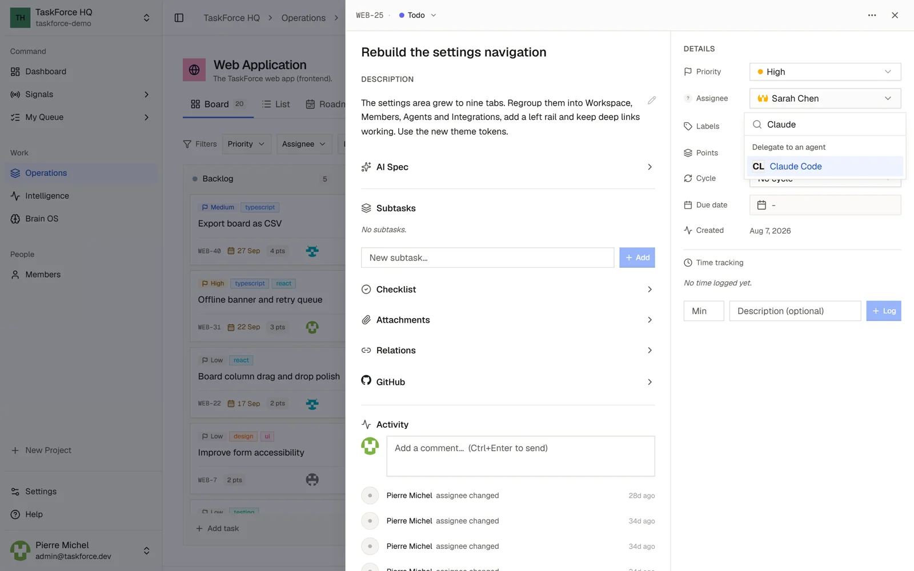

Coding agents appear in an issue's **Assignee** menu, next to the people. Choosing one delegates the issue: the agent
works on it, the issue shows what it does, and the result comes back as a pull request. Nothing is merged without a
person.

The menu only offers agents that are ready for the project. When one is missing, Settings > Agents says what it needs.



## Claude Code, on your computer

Claude Code runs on the computer of the person who delegates, with their own Claude account, through the **local
runner**. The TaskForce server cannot reach your machine: the runner asks the server for work, then starts Claude Code.

### Set it up

You need Node 20 or later, `git`, the GitHub CLI `gh` signed in, and Claude Code 2.1.293 or later, signed in once
with `claude`.

1. In TaskForce, open **Settings > Agents > Local runner** and set up your runner. TaskForce shows, once, the `.env`
   file of your runner. The runner only picks up the issues **you** delegate.
2. Get the runner, and save the `.env` file from the first step as `taskforce-runner/.env`:

   ```bash
   git clone --depth 1 https://github.com/taskforce-project/taskforce-fullstack.git
   cd taskforce-fullstack/taskforce-runner && npm install
   ```

3. Check, then start:

   ```bash
   npm run check     # token, git, gh, claude and repositories, link by link
   npm run dev       # waits for work; Ctrl+C exits after the current run
   ```

There is no repository to declare: the runner clones the project's repository with your `gh`, so with your rights,
the first time it needs it.

### During a run

- Claude Code works in a separate worktree, on a new branch: your checkout and your current branch are never touched.
- The issue shows the run live: each tool call, each failure, each refusal.
- Reading and editing files and local git commands run without asking. Anything else, such as running tests,
  installing a package or using the network, waits for your **Allow** or **Deny** on the issue. Only the person who
  delegated can answer; without an answer within 10 minutes, the action is denied.
- When the agent is done, the runner pushes the branch and opens the pull request, then posts the summary on the
  issue.
- A project without a repository works too: Claude Code then delivers its work as a comment on the issue.

TaskForce notifies you when an agent asks for approval, finishes or fails (Settings > Notifications > Coding agents).

### Stop or revoke it

`Ctrl+C` stops the runner after the current run. In Settings > Agents > Local runner, **Regenerate secret** replaces
the secret: a runner started with the old one stops working.

On a self-hosted instance, the local runner is on by default; an administrator turns it off with
`DELIVERY_LOCAL_RUNNER_ENABLED=false`.

## GitHub Copilot coding agent (preview)

The Copilot coding agent works on GitHub, in the project's repository, and opens a pull request. TaskForce starts the
task and follows it until the pull request. It needs:

- GitHub connected to the workspace (Settings > Integrations);
- a GitHub repository linked to the project;
- a GitHub account with a Copilot plan that includes the coding agent, enabled for that repository.

## Claude Code in your terminal

You can also work on your issues from your own Claude Code session: TaskForce is an MCP server that Claude Code
connects to with a personal access token. See [MCP server](/api/api-mcp).
