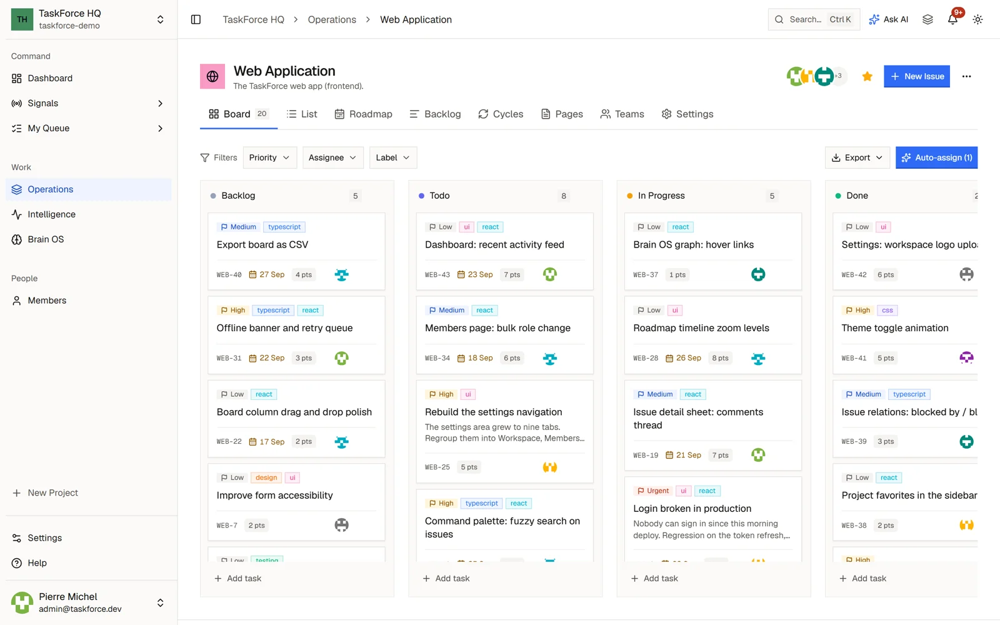
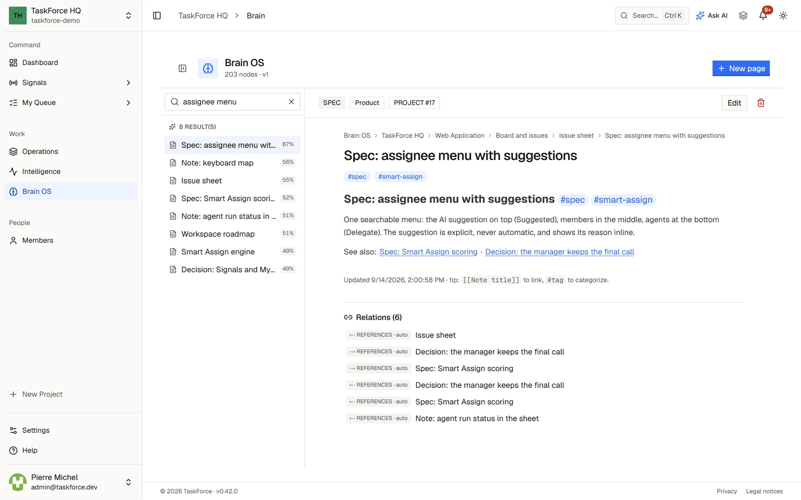

## Workspaces

A workspace is a team's space: its projects, members, Brain OS, integrations and agents. Its short name, the slug,
appears in every address (`/acme/projects`). One person can belong to several workspaces and switch between them from
the sidebar.

| Role | What it allows |
| --- | --- |
| **Owner** | Everything, including changing members' roles and deleting the workspace. |
| **Admin** | Members, invitations, integrations, webhooks and workspace settings. |
| **Member** | The everyday work in the projects. |

Invitations go to an email address. The invited person accepts the invitation in the app; nobody joins a workspace
without accepting.

## Projects

Projects are listed under **Operations** in the sidebar. Each project has a key used in its issue identifiers
(`WEB-42`) and these views:

- **Board** and **List**: the issues by status, or as a table.
- **Backlog**: the issues whose status is still in the backlog, not started yet.
- **Cycles**: time-boxed iterations, with their progress.
- **Roadmap**: the project's work on a timeline.
- **Pages**: the project's documents, written in a rich-text editor.

A project can be private: then only its members see it. Each project member has a role, **Lead**, **Member** or
**Viewer**, and viewers can read but not change anything. A project can also be linked to a GitHub repository, where
coding agents work.

## Issues

An issue carries a status, a priority, labels, a due date, story points, an assignee, subtasks, a checklist, relations
to other issues, attachments, comments and time tracking. Its activity shows who changed what, and its GitHub tab
lists the pull requests and commits linked to it.

The assignee can be a person or a coding agent: see [Coding agents](/guides/coding-agents).

## Your day

- **Dashboard**: the workspace at a glance.
- **My Queue**: your issues, cycles and pages across projects.
- **Signals**: what needs you, with mentions, alerts and assignments.
- **Intelligence**: the team's analytics.

You choose which notifications you receive in Settings > Notifications.

## Smart Assign

Smart Assign suggests the best person for an issue from skills, workload and history, and says why. It is always a
suggestion that you apply yourself: it never assigns on its own. It can also propose assignees for a whole board, and
a rebalanced workload for the team from the Members page.

## The Brain OS

The Brain OS is the workspace's knowledge base: a tree of Markdown pages with `[[links]]` between them and `#tags`.
Search works on plain text, and on meaning too when an AI model for search is configured. Notes also come from your
tools: GitHub issues, Slack channel history and Plane work items, once connected.

Cortex, the AI assistant, answers from the Brain OS and the workspace's projects: see [AI](/guides/ai).

