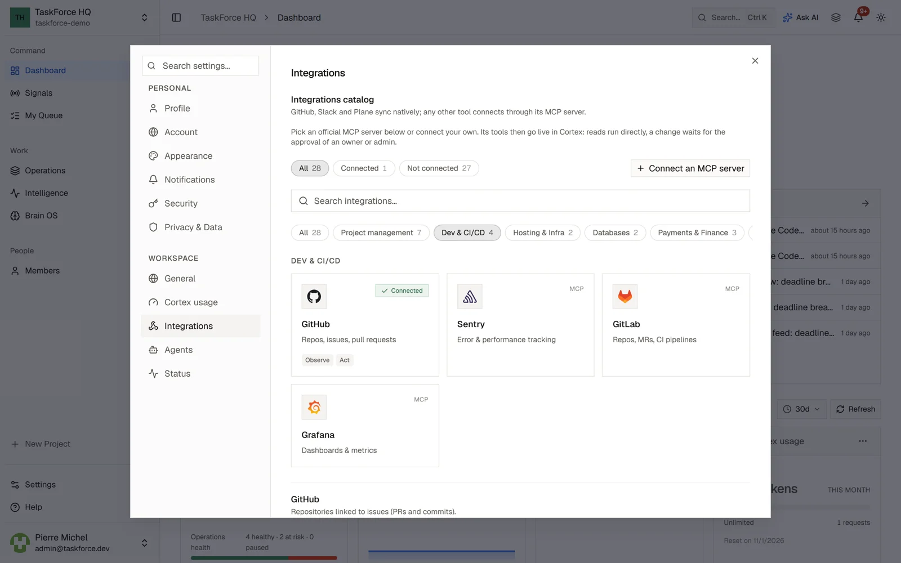

Integrations are connected per workspace, in **Settings > Integrations**, by an owner or an admin.

## GitHub

- Pull requests and commits are linked to issues from the issue's GitHub tab, and their status is kept up to date.
- Each project can be linked to one repository, or create one, in its "Code repository" section. Coding agents work in
  that repository.
- GitHub issues can be imported into the Brain OS.

TaskForce asks GitHub for the `repo` and `read:org` scopes. On a self-hosted instance, create a GitHub OAuth app with
`<TF_API_URL>/api/integrations/github/callback` as callback URL, then set `GITHUB_CLIENT_ID` and `GITHUB_CLIENT_SECRET`
in `.env`.

## Slack

- Each connected channel receives the events you choose: issue created, updated or deleted, comment added, cycle
  completed.
- A channel's history can be imported into the Brain OS.

On a self-hosted instance, create a Slack app with `<TF_API_URL>/api/integrations/slack/callback` as redirect URL and
these bot scopes: `chat:write`, `chat:write.public`, `channels:read`, `channels:history`, `users:read`,
`incoming-webhook`. Then set `SLACK_CLIENT_ID` and `SLACK_CLIENT_SECRET` in `.env`.

## Plane

Connect your Plane workspace with a personal API key and its slug, then sync a Plane project: its work items become
notes in the Brain OS.

## MCP servers

Any tool with an MCP server can be connected. The catalog, sorted by what you do (files and storage, knowledge,
tickets and projects, chat and mail, code, sales, support, finance and HR, design, other), lists the official servers
that have been tried end to end, Linear for now, and any other one can be added by its address.

Each person connects with her own account and rights; nobody uses another person's connection. An owner or admin can
share a connection with the workspace, and it shows as shared. **Connect** takes the path the vendor allows: its
sign-in in your browser when TaskForce can register on its own (dynamic registration or a client metadata document),
your company's app when the vendor requires one (an owner or admin enters its client ID and secret once, in
Settings, Integrations), or a key. When a vendor needs its admin first, TaskForce says so in one sentence, with the
message to send.

Cortex then uses the tools: reading runs directly, and a change waits for your approval (an owner's or admin's
through a shared connection). TaskForce decides which tools read: a tool it doesn't know asks, whatever the server says
about it. The list of tools is pinned when you connect: a tool whose description changes waits for your approval
again. Disconnecting revokes the access at the vendor when it allows it.

On a self-hosted instance:

- the redirect address to register at a vendor is `<TF_API_URL>/api/mcp/oauth/callback`, and the client metadata
  document is served at `<TF_API_URL>/api/mcp/oauth/client.json` (HTTPS only);
- your own app at a vendor that requires one goes in `TF_MCP_<KEY>_CLIENT_ID` and `TF_MCP_<KEY>_CLIENT_SECRET`
  (for example `TF_MCP_ASANA_CLIENT_ID`), or in Settings, Integrations, per workspace;
- MCP servers on your own network are refused unless you set `MCP_ALLOW_PRIVATE_NETWORK=true`. In the desktop app,
  a server on your computer connects once you confirm you started it.

## Webhooks

Outgoing webhooks send TaskForce events to n8n, Zapier, Make or your own endpoint, signed with HMAC-SHA256 and retried
on failure. See [Webhooks](/api/api-webhooks).
