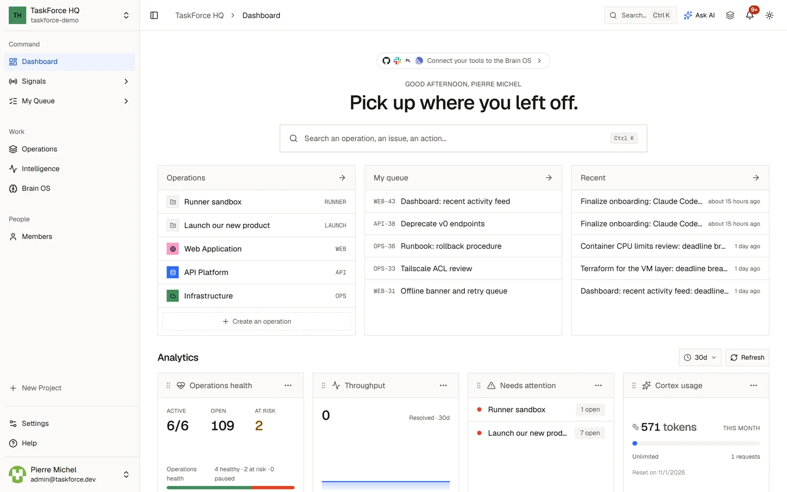

TaskForce plans a team's work and hands parts of it to coding agents. Projects, cycles and roadmaps live next to the
team's knowledge, the Brain OS, and an AI assistant, Cortex, works with both. You run it yourself, on one machine or a
server, under the AGPL-3.0 license.

<CardGroup cols={2}>
  <Card title="Self-hosting" icon="server" href="/guides/self-hosting">
    Install TaskForce with Docker, on your machine or a server.
  </Card>
  <Card title="Concepts" icon="sitemap" href="/guides/concepts">
    Workspaces, projects, issues, cycles, the Brain OS and roles.
  </Card>
  <Card title="Coding agents" icon="robot" href="/guides/coding-agents">
    Delegate an issue to Claude Code or GitHub Copilot.
  </Card>
  <Card title="API" icon="code" href="/api/api-introduction">
    Call the REST API, receive webhooks, connect an MCP client.
  </Card>
</CardGroup>

## What it does

- **Plan the work**: projects with board, list, backlog, cycles, roadmap and pages; issues with priorities, labels, due
  dates, story points, subtasks, checklists, relations, attachments and time tracking.
- **Delegate to coding agents**: Claude Code, run by each person on their own computer, and the GitHub Copilot coding
  agent appear in the Assignee menu like teammates.
- **Keep the team's knowledge**: the Brain OS, a tree of Markdown pages with links, tags and search, fed by GitHub,
  Slack and Plane.
- **Connect your tools**: GitHub, Slack, Plane, any MCP server and outgoing webhooks.

AI comes from Ollama on your machine by default, or from any OpenAI-compatible API you choose. Everything else works
without it.

## Source code

TaskForce is developed in the open on
[GitHub](https://github.com/taskforce-project/taskforce-fullstack). Issues and pull requests are welcome: start with
[CONTRIBUTING.md](https://github.com/taskforce-project/taskforce-fullstack/blob/main/CONTRIBUTING.md), and report
security problems privately as described in
[SECURITY.md](https://github.com/taskforce-project/taskforce-fullstack/blob/main/SECURITY.md).
